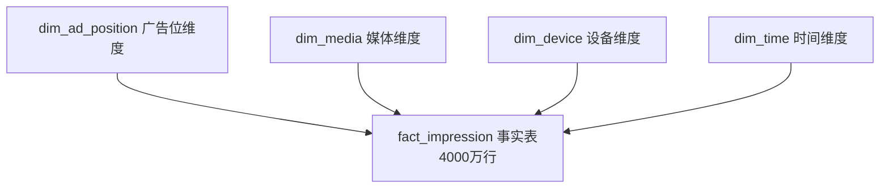

```bash
cd ~/Downloads/baidu-ctr-projrct

python << 'PY_EOF'
content = """# 百度广告点击率预测与投放优化分析

基于 Avazu 广告曝光-点击数据集（约 40428967 条记录，覆盖 10 天连续投放周期），
构建从数据治理、特征挖掘、多模型 CTR 预估到投放优化的全链路分析项目。

## 项目背景

点击率（CTR）预估是广告精准投放、流量价值最大化的核心技术底座。
本项目对标百度凤巢搜索广告与信息流广告的真实业务流程，完成以下核心目标：

1. 千万级广告行为数据的工程化治理
2. 覆盖时间、广告位、媒体内容、用户设备四大维度的全量特征体系
3. 传统机器学习与深度学习结合的多模型 CTR 预估体系
4. 广告投放优化、定向策略调整的可落地建议
5. 可复用的广告数据分析与建模工具包

## 项目结构

```text
baidu-ctr-project/
├── src/ctr_project/
│   ├── __init__.py
│   ├── config.py
│   ├── common/
│   ├── data/
│   ├── features/
│   └── models/
├── tests/
├── scripts/
├── configs/
├── docs/
├── data/
│   ├── raw/
│   ├── interim/
│   ├── processed/
│   └── reports/
├── pyproject.toml
├── requirements.txt
└── README.md
```

## 环境安装

```bash
conda create -n ctr python=3.10 -y
conda activate ctr
pip install -e .
```

## 运行流程

第一阶段：数据工程。

```bash
python -m ctr_project.data.load_data
python -m ctr_project.data.clean_data
python -m ctr_project.data.validate_quality
```

第二阶段：SQLite 建库与特征工程。

```bash
# 1. 构建星型模型并导入 SQLite 数据库
python -m ctr_project.data.sqlite_loader

# 2. 执行基础 SQL 分析（终端输出表格）
python -m ctr_project.data.sqlite_queries

# 3. 聚合维度特征并执行 IQR 异常值处理
python -m ctr_project.features.build_features
```

第三阶段：建模（待实现）。

```bash
python -m ctr_project.models.train
```

数据建模架构

### 星型模型设计



特征工程与异常处理

第一阶段（原始数据）：业务规则过滤（click 值、时间有效性）。
第二阶段（聚合特征）：对聚合出的连续指标（如 CTR、曝光量）使用 IQR / 3σ 法则进行异常值截断，防止长尾噪声干扰模型。

## 数据字段说明

| 字段名 | 类型 | 说明 |
|--------|------|------|
| id | string | 广告曝光记录唯一标识 |
| click | int | 目标变量，0=未点击，1=点击 |
| hour | string | 广告曝光时间，格式 YYMMDDHH |
| banner_pos | int | 广告位编码 |
| site_id | string | 站点唯一标识 |
| site_category | string | 站点内容类目 |
| app_id | string | 应用唯一标识 |
| app_category | string | 应用内容类目 |
| device_type | int | 设备类型编码 |
| device_model | string | 设备型号 |
| C1-C21 | string | 21 个匿名类别特征 |
```