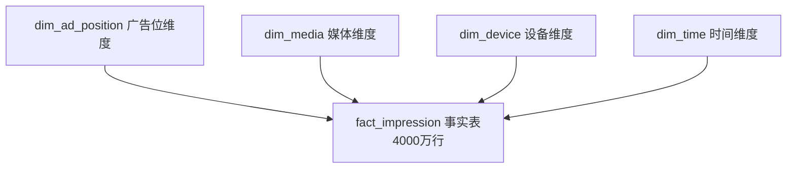

```bash
cd ~/Downloads/baidu-ctr-projrct

python << 'PY_EOF'
content = """# 百度广告点击率预测与投放优化分析

基于 Avazu 广告曝光-点击数据集（约 40428967 条记录，覆盖 10 天连续投放周期），
构建从数据治理、特征挖掘、多模型 CTR 预估到投放优化的全链路分析项目。

## 项目背景

点击率（CTR）预估是广告精准投放、流量价值最大化的核心技术底座。
本项目对标百度凤巢搜索广告与信息流广告的真实业务流程，完成以下核心目标：

1. 千万级广告行为数据的工程化治理
2. 覆盖时间、广告位、媒体内容、用户设备四大维度的全量特征体系
3. 传统机器学习与深度学习结合的多模型 CTR 预估体系
4. 广告投放优化、定向策略调整的可落地建议
5. 可复用的广告数据分析与建模工具包

## 项目结构

```text
baidu-ctr-project/
├── src/ctr_project/
│   ├── __init__.py
│   ├── config.py
│   ├── common/
│   ├── data/
│   │   ├── load_data.py              # Dask 分块加载与类型压缩
│   │   ├── clean_data.py             # 去重、时间解析、异常过滤
│   │   ├── validate_quality.py       # 五维数据质量校验与告警
│   │   ├── convert_parquet.py        # CSV ↔ Parquet 转换
│   │   ├── sqlite_loader.py          # SQLite 建库与星型模型导入
│   │   └── sqlite_queries.py         # SQL 查询交互客户端
│   ├── features/
│   │   ├── build_features.py         # 基础聚合特征构建 + IQR 异常处理
│   │   └── eda_visualizer.py         # 8 张核心 EDA 图表生成
│   └── models/
│       ├── data_loader.py            # 模型训练数据加载与编码
│       ├── train_ml.py               # LightGBM 与 LR 模型训练
│       ├── train_dl.py               # Wide & Deep (PyTorch) 训练
│       └── explain_model.py          # SHAP 可解释性分析与 A/B 测试模拟
├── tests/
├── scripts/
├── configs/
├── docs/
│   ├── data_processing_report.md     # 第一阶段数据处理报告
│   ├── literature_review.md          # 领域文献调研笔记
│   ├── eda_report.md                 # 第二阶段 EDA 报告
│   ├── stage3_model_report.md        # 第三阶段建模与评估报告
│   └── figures/                      # 所有生成的图表
├── data/
│   ├── raw/                          # 原始数据（不纳入版本控制）
│   ├── interim/                      # 中间产物（不纳入版本控制）
│   ├── processed/                    # 最终数据集、SQLite 数据库与模型文件（不纳入）
│   └── reports/                      # 质量报告
├── pyproject.toml
├── requirements.txt
└── README.md
```

## 环境安装

```bash
conda create -n ctr python=3.10 -y
conda activate ctr
pip install -e .
```

## 运行流程

第一阶段：数据工程。

```bash
python -m ctr_project.data.load_data
python -m ctr_project.data.clean_data
python -m ctr_project.data.validate_quality
```

第二阶段：SQLite 建库与特征工程。

```bash
# 1. 构建星型模型并导入 SQLite 数据库
python -m ctr_project.data.sqlite_loader

# 2. 执行基础 SQL 分析（终端输出表格）
python -m ctr_project.data.sqlite_queries

# 3. 聚合维度特征并执行 IQR 异常值处理
python -m ctr_project.features.build_features
```

第三阶段：多模型建模与可解释性

```bash
# 1. 训练 LightGBM 与 LR 基线模型
python -m ctr_project.models.train_ml

# 2. 训练 Wide & Deep 深度学习模型
python -m ctr_project.models.train_dl

# 3. 生成 SHAP 特征归因图并模拟 A/B 测试收益
python -m ctr_project.models.explain_model
```

数据建模架构

### 星型模型设计



特征工程与异常处理

第一阶段（原始数据）：业务规则过滤（click 值、时间有效性）。
第二阶段（聚合特征）：对聚合出的连续指标（如 CTR、曝光量）使用 IQR / 3σ 法则进行异常值截断，防止长尾噪声干扰模型。
核心业务结论与 A/B 测试

基线对比：LightGBM 模型在测试集上 AUC 达到 0.7337，远超逻辑回归的 0.6120；Wide & Deep 达到 0.7187 且仍在收敛。
可解释性洞察 (SHAP)：app_id、site_id 以及匿名特征 C21/C14 是影响用户点击的最核心要素。说明“在正确的媒体场景下推送正确的素材”是 CTR 提升的关键。
A/B 测试模拟：通过模型识别 Top 10% 的高潜人群进行定向提权，预估能使大盘 CTR 从 16.98% 提升至 18.48%（相对提升 8.85%）。

## 数据字段说明

| 字段名 | 类型 | 说明 |
|--------|------|------|
| id | string | 广告曝光记录唯一标识 |
| click | int | 目标变量，0=未点击，1=点击 |
| hour | string | 广告曝光时间，格式 YYMMDDHH |
| banner_pos | int | 广告位编码 |
| site_id | string | 站点唯一标识 |
| site_category | string | 站点内容类目 |
| app_id | string | 应用唯一标识 |
| app_category | string | 应用内容类目 |
| device_type | int | 设备类型编码 |
| device_model | string | 设备型号 |
| C1-C21 | string | 21 个匿名类别特征 |
```