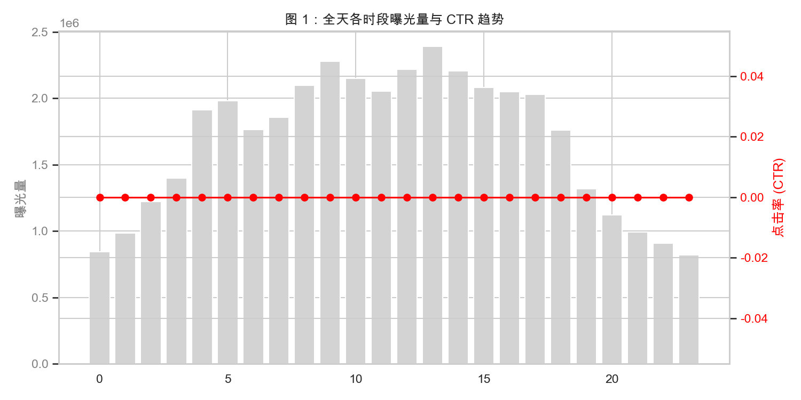
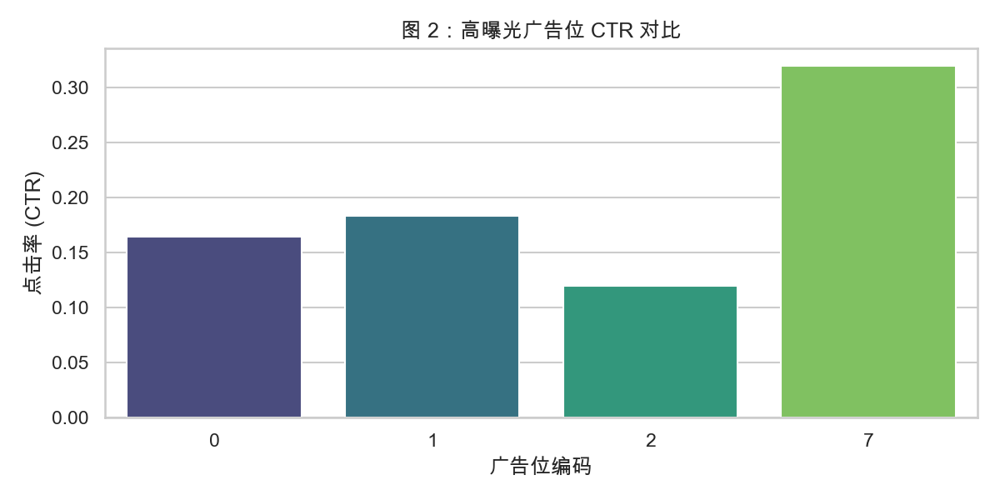
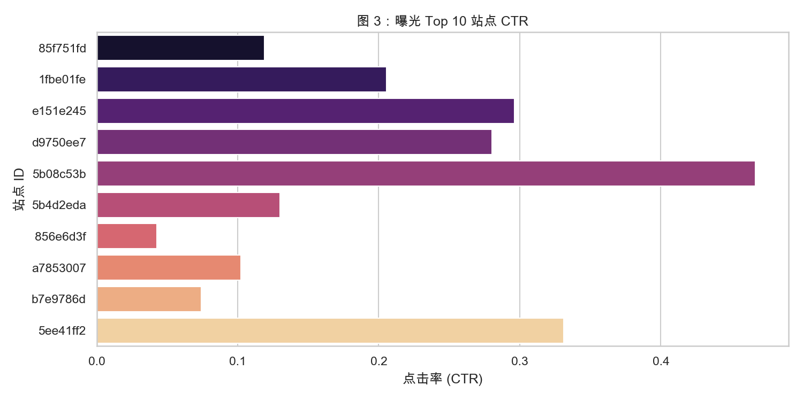
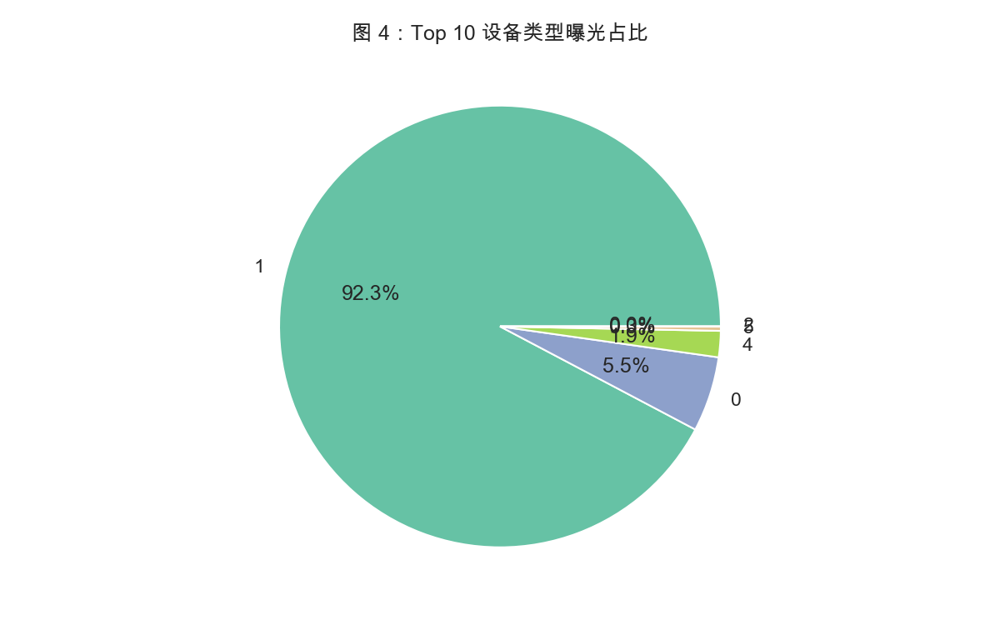

# 探索性数据分析 (EDA) 报告

## 1. 全局概览
- 总曝光：4042 万；总点击：686 万；全局 CTR：16.98%。
- 时间段：10 天（2014-10-21 至 10-30）。

## 2. 时间维度洞察

- 深夜 1:00-2:00 转化率最高（超过 18%），此时段广告竞争小，用户沉浸度高。
- 上午 8:00-10:00 转化率低迷，符合通勤时段特征。
- 建议：投放预算向深夜及午休后（15:00-16:00）倾斜。

## 3. 广告位维度洞察

- 位置 0 和 1 垄断了 99.9% 的曝光流量，是全站基本盘。
- 位置 7 曝光极低，但 CTR 高达 32%，被 IQR 平滑至 24.6% 后仍为最高。建议深挖该版位潜力，测试扩量。

## 4. 媒体与设备洞察

- 头部站点占据主要曝光，但部分长尾站点点阅极高（经 IQR 截断防止过拟合）。
- 设备类型 1 占据绝对主导（需根据饼图补充具体比例）。