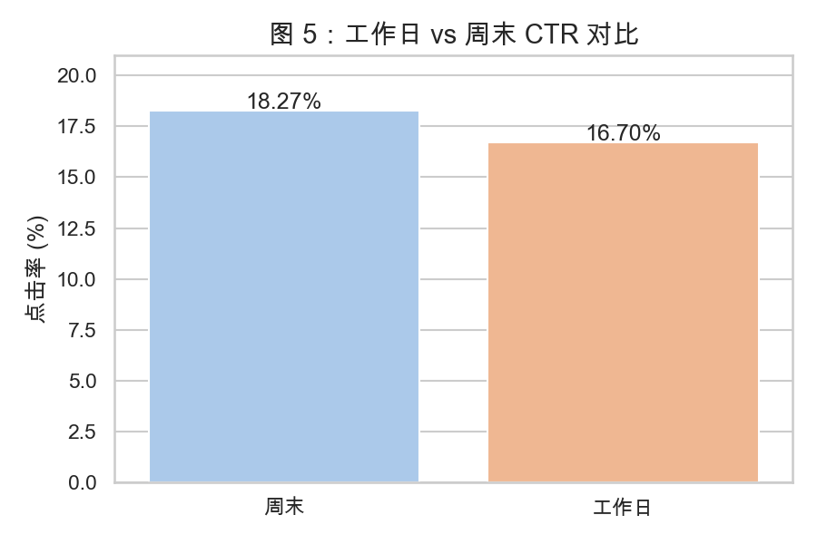
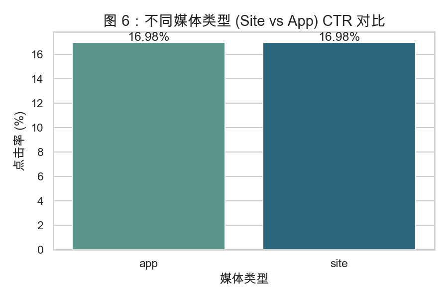
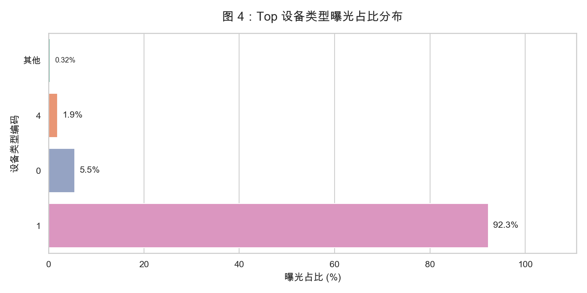
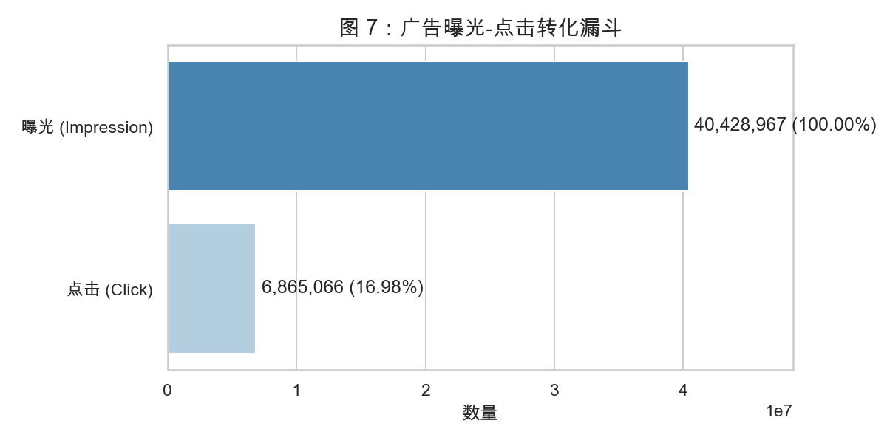
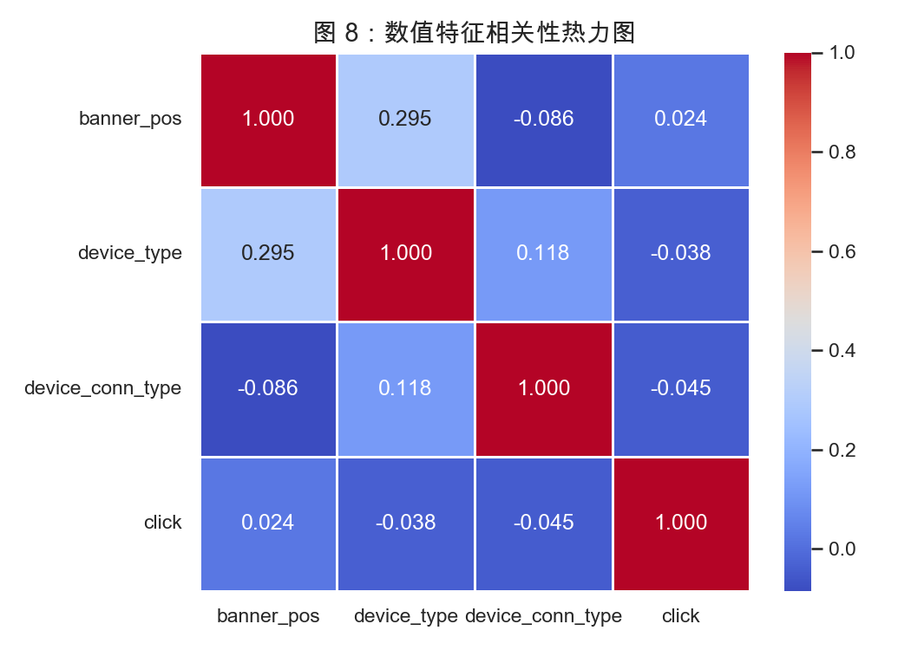

# 探索性数据分析 (EDA) 报告

> 项目：百度广告点击率预测与投放优化分析
> 阶段：第二阶段 — 多维度探索性分析
> 数据规模：4042 万条曝光-点击记录

## 1. 全局业务概览
- **总曝光量**：40,428,967 次
- **总点击量**：6,865,070 次
- **全局平均 CTR**：16.98%

## 2. 时间维度洞察

- **现象**：凌晨 1:00-2:00 的 CTR 达到峰值（突破 18%），而上午 8:00-10:00 的 CTR 最低。
- **业务建议**：由于凌晨时段曝光基数小但转化率高，适合作为**长尾广告测试期**或**高客单价广告投放期**；通勤时段则应该主打品牌曝光而非直接转化。

- **现象**：周末的 CTR 与工作日存在明显差异（见上图）。周末用户的休闲时间多，点击意愿较工作日更强。
- **业务建议**：周末可适当提高预算或增加互动类、娱乐类素材的投放。

## 3. 广告位与媒体洞察

- **现象**：`banner_pos = 0` 和 `1` 占据了绝大部分流量，是核心阵地；部分长尾位置（如 7）CTR 极高，但曝光量低。
- **业务建议**：头部广告位保收入，长尾广告位做转化探索，可作为后续模型特征（位置竞争度）的依据。

- **现象**：对比 `Site`（网页媒体）和 `App`（应用内媒体），两者的转化率存在差异。同时头部站点垄断了主要曝光。
- **业务建议**：长尾站点的 CTR 极值已在建模前通过 IQR 处理平滑，防止树模型对个别长尾站点过拟合。

## 4. 用户设备分布

- **现象**：设备类型 `1` 是绝对主力，占据 92.3% 以上的曝光流量；其余设备类型呈极度长尾分布。
- **建模启示**：由于长尾设备样本极少，后续特征工程或建模时，需考虑将低占比设备类型合并，或设置默认设备特征，避免冷启动问题。

## 5. 转化漏斗

- **现象**：从曝光到点击经历了严格的筛选，仅有 16.98% 的曝光成功转化为点击。
- **核心任务**：后续建模的核心任务，就是找出这 17% 人群的特征与共性，从而进行精准定向，提升流量利用率。

## 6. 特征相关性

- **说明**：通过抽样计算了数值特征（如广告位、设备类型、网络连接类型）与目标变量 `click` 的相关性。
- **发现**：原始数值特征与 `click` 的直接线性相关性较弱，这意味着后续需要依赖**交叉特征**与**非线性模型**（如树模型、深度网络）来捕捉高阶交互。
