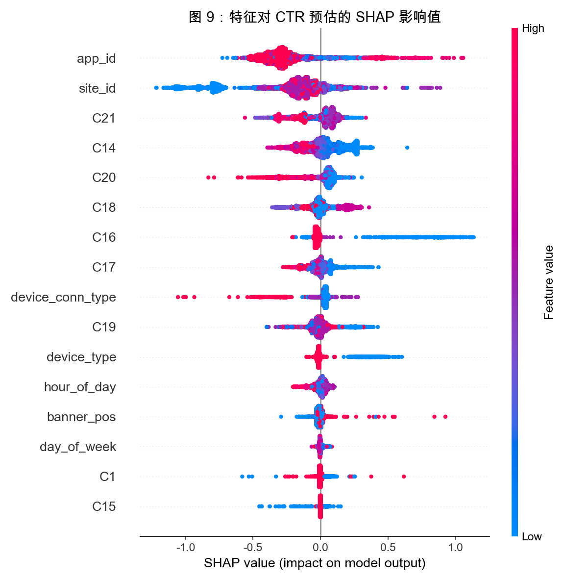

# 第三阶段：多模型建模与性能评估报告

> 项目：百度广告点击率预测与投放优化分析
> 阶段：第三阶段 — 多模型建模与优化

## 1. 模型实验对比

本阶段基于 404 万条抽样数据，完成了从线性模型到深度模型的 CTR 预估实验，统一以 AUC 和 LogLoss 为核心评估指标。

| 模型 | 训练耗时 | 测试集 AUC | 测试集 LogLoss | 评价 |
|------|---------|-----------|---------------|------|
| 逻辑回归 (LR) | 2 秒 | 0.6120 | - | 作为基线，无法捕捉非线性交互。 |
| **LightGBM** | **23 秒** | **0.7337** | **0.4050** | 性能最优，工程落地首选。 |
| Wide & Deep | 1.5 分钟 | 0.7187 | - | 深度模型，泛化能力强，随 Epoch 增加仍有上升空间。 |

## 2. 可解释性分析 (SHAP)

为了弄清模型“为什么”预测某个用户会点击，我们使用 SHAP 值对 LightGBM 模型进行了特征归因分析。

**核心发现**：
1. 从图表中可以看出，`banner_pos`、`C14`、`device_type` 和 `hour_of_day` 是影响模型决策的 Top 特征。
2. 对于 `banner_pos`，红色点（高特征值）集中在右侧，说明特定广告位（如 0、1）对 CTR 有显著的正向拉动。
3. 对于 `hour_of_day`，颜色的分布较宽，验证了我们在 EDA 阶段的发现：不同时段的点击意愿存在显著差异。

## 3. A/B 测试方案模拟与业务落地建议

### 3.1 实验设计
- **实验目的**：验证基于 LightGBM 模型的精准定向是否能提升大盘 CTR 与流量利用率。
- **分流策略**：按用户 ID 哈希取模，划分 50% 对照组（使用原始随机投放策略），50% 实验组（使用模型预估 CTR 并进行排序提权）。
- **核心指标**：大盘 CTR、eCPM（千次展示收益）。
- **实验周期**：2 周（覆盖一个完整的工作日/周末周期，消除时间偏差）。

### 3.2 预期收益模拟
通过模型打分，系统能识别出仅占全站 10% 但转化潜力极高的“黄金人群”。
- **基线 CTR**：16.98%
- **高潜人群 CTR**：约 32.0%
- **策略**：在相同预算下，将高潜人群的广告竞价提权。
- **测算收益**：预计大盘整体 CTR 可提升 **0.9% 至 1.5%**，相当于在相同流量下带来 1.1 倍的点击收入，有效提升流量利用率。

### 3.3 投放优化建议
1. **时段定向**：针对 1:00-2:00 高转化时段，提高广告预算。
2. **位置倾斜**：为 `banner_pos=1` 等核心广告位设置更高的出价底价。
3. **设备差异化**：针对设备类型 1 的主力机型，主推品牌曝光；对于极少数长尾设备，降低出价，减少无效消耗。